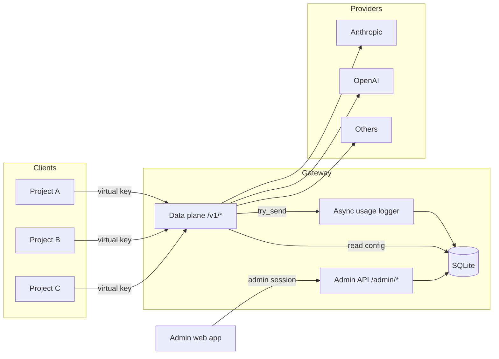
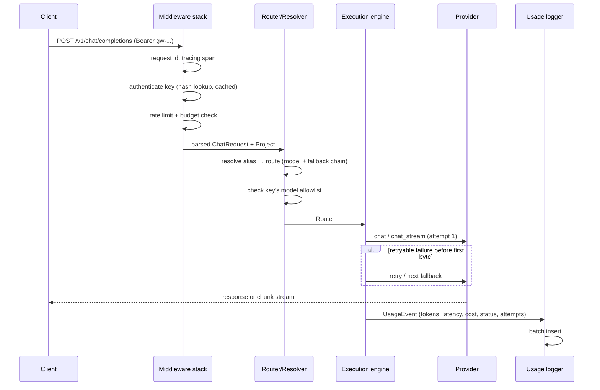
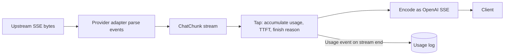
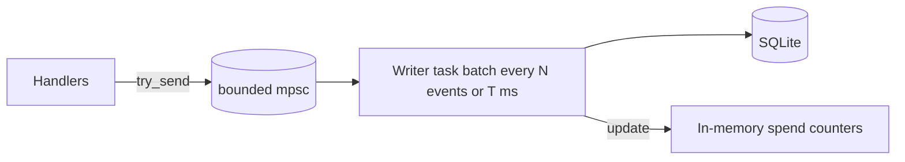
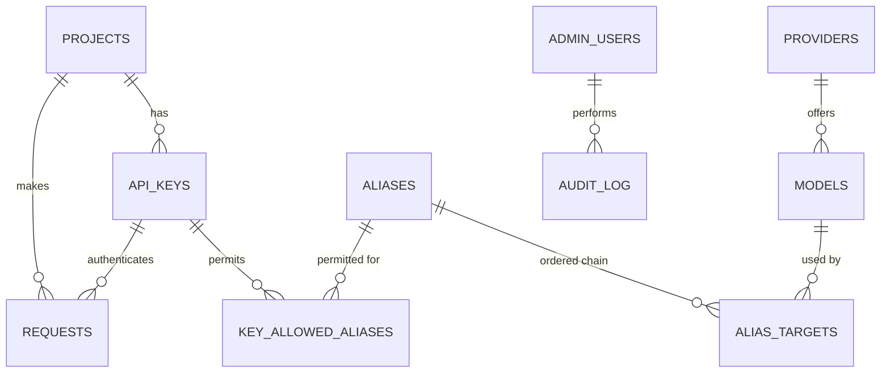
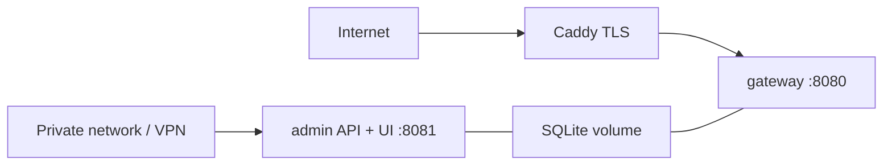

# LLM Gateway — Architecture

This document describes how the gateway described in `product.md` is structured: components, request flows, data model, key abstractions, and the design decisions behind them.

## 1. System context



Two planes, one process (initially):

| | Data plane | Control plane |
|------|-----------|---------------|
| Purpose | Serve LLM traffic | Configure and observe the gateway |
| Callers | Projects | Admin web app, CLI |
| Auth | Virtual API keys | Admin login / admin token |
| Traffic | High volume, latency-sensitive, streaming | Low volume, CRUD and queries |
| Port | 8080 | 8081 (separate listener) |

They share the core and storage crates but run as separate axum routers on separate listeners, so they can be firewalled, scaled, or split into two binaries later.

## 2. Workspace and crates

```
gateway/
├── Cargo.toml                 # workspace
├── crates/
│   ├── core/                  # domain types, errors, no I/O
│   ├── providers/             # Provider trait + adapters
│   ├── storage/               # sqlx models, repositories, migrations
│   ├── gateway/               # data plane: routes, middleware, routing engine
│   ├── admin-api/             # control plane: routes, admin auth
│   └── server/                # binary: config, wiring, startup, shutdown
├── admin-ui/                  # web app
├── tests/                     # integration tests + mock provider
└── docker/
```

Dependency direction (no cycles):

```
server ──► gateway ──► providers ──► core
   │          │
   │          └────────► storage ──► core
   └──► admin-api ─────► storage
```

- **core**: pure types (`ChatRequest`, `ChatChunk`, `Usage`, error enums). No network, no DB.
- **providers**: knows how to talk to upstreams; knows nothing about projects, keys, or the DB.
- **storage**: repositories over sqlx; knows nothing about HTTP.
- **gateway**: orchestrates auth, limits, routing, retries, and logging for one request.

## 3. Core abstractions

### 3.1 Normalized types (core)

```rust
pub struct ChatRequest {
    pub model: String,                 // alias on input, real model after resolution
    pub messages: Vec<Message>,
    pub stream: bool,
    pub max_tokens: Option<u32>,
    pub temperature: Option<f32>,
    pub tools: Option<Vec<Tool>>,
    pub response_format: Option<ResponseFormat>,
    pub extra: serde_json::Map<String, Value>,   // provider-specific passthrough
}

pub struct Usage {
    pub input_tokens: u32,
    pub output_tokens: u32,
    pub cached_input_tokens: Option<u32>,
}

pub struct ChatChunk {
    pub delta: Delta,                  // text, tool-call fragments
    pub finish_reason: Option<FinishReason>,
    pub usage: Option<Usage>,          // present on the final chunk
}
```

### 3.2 Provider trait (providers)

```rust
#[async_trait]
pub trait Provider: Send + Sync {
    fn id(&self) -> &str;

    async fn chat(&self, req: ChatRequest) -> Result<ChatResponse, ProviderError>;

    async fn chat_stream(
        &self,
        req: ChatRequest,
    ) -> Result<BoxStream<'static, Result<ChatChunk, ProviderError>>, ProviderError>;
}
```

`ProviderError` distinguishes what matters for routing:

```rust
pub enum ProviderError {
    RateLimited { retry_after: Option<Duration> },   // retryable
    Upstream5xx { status: u16 },                      // retryable
    Timeout,                                          // retryable
    Network(reqwest::Error),                          // retryable
    BadRequest { status: u16, body: Value },          // NOT retryable, pass to client
    Auth,                                             // NOT retryable, alert operator
    Stream(String),                                   // mid-stream failure
}
```

### 3.3 Provider registry

An in-memory `HashMap<ProviderId, Arc<dyn Provider>>` built at startup and rebuilt on config reload (see section 8). Adapters hold their own `reqwest::Client` clone (cheap, shares the connection pool).

## 4. Request lifecycle (data plane)



### 4.1 Middleware stack (outermost first)

1. **Request ID:** generate or accept `X-Request-Id`, attach to the tracing span.
2. **Tracing/metrics:** span per request with project, model, and status.
3. **Body size limit:** reject oversized requests early.
4. **Auth:** extract the bearer key, hash it, look it up (with a short-TTL in-memory cache), attach `AuthContext { project_id, key_id, limits, allowed_models }`.
5. **Rate limiter:** token bucket per key; reject with 429 and `Retry-After`.
6. **Budget check:** compare month-to-date spend (cached counter) with the project cap.
7. **Handler:** parse, resolve, execute.

Implemented as tower layers so each is independently testable.

### 4.2 Alias resolution

```
alias "smart" ──► Route {
    primary:   { provider: anthropic, model: "claude-…" },
    fallbacks: [ { provider: openai, model: "gpt-…" } ],
    timeout:   60s,
    retries:   2,
}
```

Resolution reads from an in-memory snapshot of the routing config, not the DB, on the hot path.

### 4.3 Execution engine: retries and fallbacks

```
for target in [primary, ...fallbacks]:
    for attempt in 1..=max_retries:
        result = provider.call(target)
        match result:
            Ok                          → return
            Err(retryable)              → sleep(backoff + jitter, or Retry-After); continue
            Err(non-retryable)          → return error immediately
    // retries exhausted → next fallback target
return last error
```

Rules:

- **Non-streaming:** full retry and fallback logic.
- **Streaming:** retries and fallbacks apply only until the first chunk is received. After that the stream is committed; a mid-stream failure is surfaced as a final SSE error event and recorded in the log.
- Each attempt is recorded in an `attempts` array (provider, model, outcome, latency) stored with the request log.
- A circuit breaker per provider (closed → open → half-open) skips providers that are failing consistently.

### 4.4 Streaming pipeline



- The response body is a `Stream` handed straight to axum, so there is no full buffering.
- The tap wraps the stream to measure time to first token, collect the final usage, and emit the usage event when the stream ends or is dropped.
- **Client disconnect:** axum drops the response stream; dropping the upstream reqwest response body cancels the upstream request. The tap's `Drop` handler emits a usage event with status `client_cancelled` and whatever tokens were observed.

## 5. Usage logging



- Handlers use `try_send`. If the channel is full, the event is dropped and a metric is incremented. Logging must never add latency or cause a request to fail.
- The writer flushes in batches (for example every 100 events or 500 ms) in a single transaction.
- On graceful shutdown, the server stops accepting requests, waits for in-flight streams, then drains the channel before exiting.
- Spend counters per project (month-to-date) are kept in memory, rebuilt from the DB at startup, and updated by the writer, which keeps budget checks off the DB.

**Cost calculation:** `cost = input_tokens × input_price + output_tokens × output_price (+ cached-token pricing)`, using the pricing row in effect at request time. The price used is stored on the log row so later price edits don't rewrite history.

## 6. Data model



Tables (SQLite, abbreviated):

```sql
CREATE TABLE projects (
  id              TEXT PRIMARY KEY,          -- uuid
  name            TEXT NOT NULL UNIQUE,
  monthly_budget_usd REAL,                   -- NULL = unlimited
  created_at      TEXT NOT NULL
);

CREATE TABLE api_keys (
  id              TEXT PRIMARY KEY,
  project_id      TEXT NOT NULL REFERENCES projects(id),
  prefix          TEXT NOT NULL,             -- first chars, for display ("gw-ab12…")
  key_hash        BLOB NOT NULL UNIQUE,      -- SHA-256 of the secret
  rpm_limit       INTEGER,
  tpm_limit       INTEGER,
  expires_at      TEXT,
  revoked_at      TEXT,
  created_at      TEXT NOT NULL
);

CREATE TABLE providers (
  id              TEXT PRIMARY KEY,          -- 'anthropic', 'openai'
  kind            TEXT NOT NULL,             -- adapter type
  base_url        TEXT NOT NULL,
  credentials_enc BLOB NOT NULL,             -- encrypted at rest
  timeout_ms      INTEGER NOT NULL,
  enabled         INTEGER NOT NULL DEFAULT 1
);

CREATE TABLE models (
  id              TEXT PRIMARY KEY,
  provider_id     TEXT NOT NULL REFERENCES providers(id),
  upstream_name   TEXT NOT NULL,             -- real model name
  input_price_per_mtok  REAL NOT NULL,
  output_price_per_mtok REAL NOT NULL,
  cached_input_price_per_mtok REAL
);

CREATE TABLE aliases (
  id              TEXT PRIMARY KEY,
  name            TEXT NOT NULL UNIQUE,      -- 'fast', 'smart'
  max_retries     INTEGER NOT NULL DEFAULT 2,
  timeout_ms      INTEGER
);

CREATE TABLE alias_targets (
  alias_id        TEXT NOT NULL REFERENCES aliases(id),
  position        INTEGER NOT NULL,          -- 0 = primary, 1.. = fallbacks
  model_id        TEXT NOT NULL REFERENCES models(id),
  PRIMARY KEY (alias_id, position)
);

CREATE TABLE key_allowed_aliases (            -- empty = all aliases allowed
  key_id          TEXT NOT NULL REFERENCES api_keys(id),
  alias_id        TEXT NOT NULL REFERENCES aliases(id),
  PRIMARY KEY (key_id, alias_id)
);

CREATE TABLE requests (
  id              TEXT PRIMARY KEY,          -- request id
  ts              TEXT NOT NULL,
  project_id      TEXT NOT NULL,
  key_id          TEXT NOT NULL,
  alias           TEXT NOT NULL,
  provider_id     TEXT,                      -- final provider used
  model           TEXT,                      -- final upstream model
  tag             TEXT,                      -- from X-Gateway-Tag
  stream          INTEGER NOT NULL,
  input_tokens    INTEGER,
  output_tokens   INTEGER,
  cached_tokens   INTEGER,
  cost_usd        REAL,
  latency_ms      INTEGER,
  ttft_ms         INTEGER,
  status          TEXT NOT NULL,             -- ok | error | client_cancelled | rate_limited ...
  http_status     INTEGER,
  error_kind      TEXT,
  attempts_json   TEXT,                      -- per-attempt outcomes
  request_body    TEXT,                      -- only if full logging enabled
  response_body   TEXT
);
CREATE INDEX idx_requests_project_ts ON requests(project_id, ts);
CREATE INDEX idx_requests_ts ON requests(ts);

CREATE TABLE admin_users (
  id TEXT PRIMARY KEY, email TEXT UNIQUE NOT NULL,
  password_hash TEXT NOT NULL, role TEXT NOT NULL, created_at TEXT NOT NULL
);

CREATE TABLE audit_log (
  id TEXT PRIMARY KEY, ts TEXT NOT NULL, admin_id TEXT,
  action TEXT NOT NULL, target TEXT, detail_json TEXT
);
```

**Notes**

- **Keys:** generate 32+ random bytes, format as `gw-<base64url>`, show once, store only the SHA-256 hash and a display prefix. SHA-256 is sufficient for high-entropy secrets; use Argon2 for admin passwords.
- **Provider credentials:** encrypted with a master key from the environment (for example AES-256-GCM via `aes-gcm`); the master key is never stored in the DB.
- Run SQLite in WAL mode so the writer task and readers don't block each other.
- Time series for the dashboard are computed from `requests` with `GROUP BY` on a time bucket; add rollup tables only if queries get slow.

## 7. Control plane (admin API)

Resource-oriented REST, JSON, versioned under `/admin/v1`:

| Resource | Operations |
|----------|------------|
| `/projects` | list, create, update (budget), delete |
| `/projects/{id}/keys` | list, create (returns secret once), revoke, update limits |
| `/providers` | list, create, update, test connection |
| `/models` | list, create, update pricing |
| `/aliases` | list, create, update targets and fallback order |
| `/usage` | query by project, model, alias, tag, time range, bucket |
| `/requests` | paginated log search, request detail |
| `/audit` | list admin actions |
| `/auth/login`, `/auth/logout` | admin session |

Admin auth: email and password, session cookie (HttpOnly, SameSite=Strict) or short-lived bearer token. A bootstrap admin is created from env vars on first start.

Every mutating call writes an `audit_log` row.

OpenAPI spec generated with `utoipa`; the admin UI can generate its client from it.

## 8. Configuration and hot reload

Two layers:

- **Static config (TOML + env):** listen addresses, DB path, master encryption key, log level, default timeouts, logging mode. Changing it needs a restart.
- **Dynamic config (database):** providers, models, aliases, pricing, key limits. Changeable at runtime through the admin API.

**Hot reload mechanism**

- The hot path reads from an `Arc<ArcSwap<ConfigSnapshot>>` (`arc-swap` crate): lock-free reads.
- When the admin API mutates config, it writes to the DB, rebuilds a new snapshot (providers, routes, pricing, key cache invalidation), and swaps it atomically.
- In-flight requests keep the snapshot they started with, so a config change never affects a request mid-flight.

## 9. Security

| Concern | Approach |
|---------|----------|
| Provider keys | Only in the gateway, encrypted at rest, never logged or returned by the API |
| Client keys | Hashed, revocable, expirable, per-project |
| Plane separation | Admin API on a separate listener, bound to localhost or a private network by default |
| Transport | TLS terminated by a reverse proxy (Caddy); gateway speaks HTTP behind it |
| Logging | Default: metadata only. Full prompt/response logging is opt-in per project; redact the `Authorization` header always |
| Abuse | Body size limits, per-key rate limits, concurrency caps |
| Admin | Argon2 password hashing, login throttling, audit log |
| Errors | Never leak upstream credentials or internal details in error bodies |

## 10. Error model

Client-facing errors follow the OpenAI shape so SDKs handle them natively:

```json
{ "error": { "message": "...", "type": "rate_limit_error", "code": "rate_limit_exceeded" } }
```

| Situation | HTTP | `type` |
|-----------|------|--------|
| Missing/invalid/revoked key | 401 | `authentication_error` |
| Alias not allowed for key | 403 | `permission_error` |
| Unknown alias | 404 | `invalid_request_error` |
| Malformed request, upstream 400 | 400 | `invalid_request_error` |
| Gateway rate limit or budget exceeded | 429 | `rate_limit_error` / `budget_exceeded` |
| All upstream targets failed | 502 | `upstream_error` |
| Upstream timeout | 504 | `timeout_error` |
| Gateway internal error | 500 | `internal_error` |

Mid-stream failures are sent as a final `data:` SSE event containing an error object, followed by stream termination.

## 11. Observability

- **Logs:** `tracing` with JSON output; every line carries `request_id`, project, alias.
- **Metrics** (`/metrics`, Prometheus format), later: request count, latency histogram, TTFT histogram, tokens, cost, upstream errors by provider, retries, fallbacks, circuit-breaker state, dropped log events.
- **Traces:** OpenTelemetry export, with a span per upstream attempt.
- **Health:** `/health` (process alive), `/ready` (DB reachable, config loaded, at least one provider enabled).

## 12. Concurrency and performance notes

- Single tokio multi-thread runtime; handlers are fully async; no blocking calls on the runtime (use `spawn_blocking` for CPU-heavy or blocking work).
- One shared `reqwest::Client` per provider with connection pooling and HTTP/2 where supported.
- Auth key lookups are cached in memory (TTL of seconds) and invalidated on revoke.
- Rate-limiter state is in memory (`DashMap` of token buckets). This is acceptable for a single instance; a multi-instance deployment would need Redis or sticky routing, which is out of scope for v1.
- SQLite has a single writer; all writes (usage logging, admin mutations) go through bounded paths so they can't starve each other.

## 13. Testing strategy

| Level | What | How |
|-------|------|-----|
| Unit | Type conversions, cost calculation, backoff, rate limiter, alias resolution | Plain `cargo test` |
| Adapter | Provider request/response and stream parsing | Recorded fixtures of real provider payloads |
| Integration | Full gateway against a mock provider (axum server) | Scenarios: success, slow, 429 with `Retry-After`, 500, mid-stream cut, malformed SSE |
| Contract | OpenAI SDKs (Python/TS) against the gateway | Confirms real clients work, including streaming and errors |
| Admin | Admin API CRUD, auth, audit trail | In-memory SQLite per test |
| Load (later) | Concurrency, streaming under load, client disconnect storms | `oha` or `k6` against the mock provider |

The mock provider is built in M1 and reused through every later milestone.

## 14. Deployment



Single container image; SQLite database on a mounted volume; regular backups via `sqlite3 .backup` or Litestream.

`docker-compose` runs the gateway and Caddy; the admin port is not published publicly.

Environment: `GATEWAY_MASTER_KEY`, `DATABASE_URL`, `ADMIN_BOOTSTRAP_EMAIL` / `ADMIN_BOOTSTRAP_PASSWORD`, `RUST_LOG`.

Graceful shutdown on SIGTERM: stop accepting connections, let in-flight streams finish (bounded by a timeout), drain the log channel, close the DB.

## 15. Key decisions and trade-offs

| Decision | Alternative | Why this choice |
|----------|-------------|-----------------|
| OpenAI-compatible API as the client contract | Custom API | Works with existing SDKs and frameworks with no client code changes |
| Separate data and control plane routers | One router | Different auth and traffic profiles; easy to split later |
| SQLite first | Postgres | Zero-ops, ideal for learning and single-instance use; sqlx keeps a Postgres move feasible |
| Async batched usage logging | Synchronous insert per request | Keeps logging off the hot path; accepts rare event loss under overload |
| In-memory config snapshot with ArcSwap | Query the DB per request | Lock-free reads and consistent per-request view |
| No retry after first streamed byte | Try to resume streams | Resuming is not generally possible; keeps semantics honest |
| In-memory rate limiting | Redis | Sufficient for a single instance; avoids an extra dependency |
| Provider passthrough via `extra` | Full normalization of every feature | Avoids a lowest-common-denominator API while keeping the core normalized |

## 16. Extension points

- **New provider:** implement `Provider`, add a `kind` to the registry. No other layer changes.
- **New middleware (guardrails, caching):** add a tower layer between auth and the handler.
- **Caching:** a layer keyed on a hash of the normalized request; bypass via header.
- **Native `/v1/messages`:** a second route that translates Anthropic-format requests into `ChatRequest` and back.
- **Postgres:** swap the sqlx backend feature and adjust migrations; repositories hide the database from the rest of the code.
- **Multi-instance:** move rate limiting and spend counters to a shared store such as Redis.
