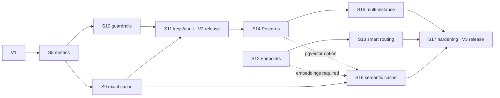

# LLM Gateway — Sprint Planning: V2 and V3

Continuation of `sprint-planning.md` (S1–S7 delivered V1). Sprint numbering continues from S8. Same working agreement: 2-week sprints, ~20 hours capacity, plan to ~80%, points 1/2/3/5 (split anything larger), WIP limit of 2.

Entry criteria for V2: V1 is released (v1.0.0 tagged), two real projects run through the gateway, and the retro action items from S7 are resolved.

## 1. Roadmap overview

| Sprint | Version | Theme | Outcome |
|--------|---------|-------|---------|
| S8 | V2 | Metrics and tracing | Prometheus `/metrics`, OpenTelemetry traces, health refinements |
| S9 | V2 | Exact-match caching | Cache with TTL, bypass header, cost savings visible |
| S10 | V2 | Guardrails | PII redaction, blocked patterns, size and content rules |
| S11 | V2 | Key lifecycle and audit; V2 release | Key rotation, richer audit views, UI updates, v2.0.0 |
| S12 | V3 | More endpoints | Native `/v1/messages` and `/v1/embeddings` |
| S13 | V3 | Smart routing | A/B and canary routing, rule-based routing |
| S14 | V3 | Postgres | Pluggable storage backend with migration path |
| S15 | V3 | Multi-instance | Shared rate limiting, spend counters, config propagation |
| S16 | V3 | Semantic caching | Embedding-based cache with similarity threshold |
| S17 | V3 | Hardening; V3 release | Load and chaos tests, docs, v3.0.0 |

**Checkpoints:** V2 ships at the end of S11, V3 at the end of S17.

## Part A — V2

## Sprint 8 — Metrics and tracing

**Goal:** the gateway is observable by standard tooling, not just by querying SQLite.

**Demo:** a Grafana dashboard (or raw `/metrics` output) shows request rate, latency percentiles, and errors per provider; a trace shows a request with its retry and fallback attempts as child spans.

| # | Task | Pts | Acceptance criteria |
|---|------|-----|---------------------|
| 8.1 | Metrics crate setup and `/metrics` endpoint (on the admin listener) | 3 | Prometheus format; not exposed on the public data-plane port |
| 8.2 | Core metrics: request count, latency histogram, TTFT histogram, tokens, cost, in-flight requests | 5 | Labels limited to low-cardinality values (project, alias, provider, status) |
| 8.3 | Upstream metrics: errors by provider and kind, retries, fallbacks, circuit-breaker state | 3 | Matches the attempt data in the request log |
| 8.4 | Operational metrics: log channel depth, dropped usage events, DB write latency | 2 | Dropped events visible on a counter |
| 8.5 | OpenTelemetry tracing: root span per request, child span per upstream attempt | 5 | Spans carry project, alias, provider, model, status; no prompt content |
| 8.6 | OTLP exporter configurable via env; disabled by default | 2 | No overhead when disabled |
| 8.7 | Sampling configuration (always sample errors, probabilistic for success) | 2 | Configurable ratio |
| 8.8 | Starter Grafana dashboard JSON and docker-compose observability profile | 3 | One command brings up Prometheus and Grafana with the dashboard |
| 8.9 | Refine `/ready`: DB check, config loaded, at least one healthy provider | 1 | Returns 503 with a reason when not ready |

**Total:** 26 pts (cut 8.8 or 8.7 if behind)
**Learning focus:** metric design and cardinality, OpenTelemetry in Rust, correlating logs, metrics, and traces.
**Risks:** label cardinality explosions (never label by key ID, request ID, or raw model input).

## Sprint 9 — Exact-match caching

**Goal:** identical requests can be served from cache, with clear controls and visible savings.

**Demo:** the same request sent twice, where the second returns instantly and is logged as a cache hit with $0 cost and the saved cost recorded.

| # | Task | Pts | Acceptance criteria |
|---|------|-----|---------------------|
| 9.1 | Cache key design: hash of normalized request (alias, messages, params, tools); project scoped by default | 3 | Documented; semantically equal requests normalize to the same key |
| 9.2 | Cache storage trait with in-memory (`moka`) implementation | 3 | Size and TTL bounds; eviction works |
| 9.3 | Cache layer in the request path (non-streaming) | 3 | Hit skips the provider and returns the stored response |
| 9.4 | Streaming cache support: store the assembled response and replay it as an SSE stream | 5 | Replayed stream is indistinguishable to the SDK |
| 9.5 | Controls: per-alias enable and TTL, `X-Gateway-Cache: bypass` and `no-store` headers | 3 | Honored and tested |
| 9.6 | Never-cache rules: errors, truncated or cancelled streams, requests with high temperature (configurable), tool-calling when disabled | 3 | Test per rule |
| 9.7 | Log fields: `cache_status` (hit, miss, bypass), `saved_cost_usd` | 2 | Migration applied; visible in the request log |
| 9.8 | Metrics: hit ratio, saved cost | 2 | Exposed on `/metrics` |
| 9.9 | Admin API and UI: cache settings per alias, purge by alias or project | 3 | Purge takes effect immediately |

**Total:** 27 pts (stretch; 9.4 is the riskiest, 9.9 can slip)
**Learning focus:** cache key normalization, correctness vs. hit rate, replaying streams.
**Risks:** serving stale or cross-project data. Cache keys include the project by default; shared caching must be an explicit opt-in.

## Sprint 10 — Guardrails

**Goal:** configurable protections applied before requests reach providers and before sensitive data reaches logs.

**Demo:** a prompt containing an email and a card number is redacted in logs (and optionally in the upstream request); a request matching a blocked pattern is rejected with a clear error.

| # | Task | Pts | Acceptance criteria |
|---|------|-----|---------------------|
| 10.1 | Guardrail pipeline abstraction: ordered stages with Allow, Modify, Reject outcomes | 3 | Pipeline unit-tested independently of HTTP |
| 10.2 | Input size and structure checks (max messages, max prompt chars, allowed roles) | 2 | Rejects with a 400 and a specific error code |
| 10.3 | Regex blocklist and allowlist rules per project | 3 | Rules editable via the admin API |
| 10.4 | PII detector: emails, phone numbers, credit cards (Luhn check), common ID formats | 5 | Test corpus with true and false positives documented |
| 10.5 | Redaction modes: log-only redaction vs. redact before sending upstream | 3 | Configurable per project; default is log-only |
| 10.6 | Response-side checks (blocked patterns, redact in logs) | 3 | Streaming responses handled with a rolling buffer |
| 10.7 | Optional external moderation hook (HTTP call, with timeout and fail-open or fail-closed setting) | 3 | Failure mode configurable and tested |
| 10.8 | Guardrail decisions recorded in the request log (`guardrail_action`, `rule_id`) | 2 | Never store the matched sensitive content |
| 10.9 | Admin UI: rules editor and a test box ("would this input be blocked?") | 3 | Dry-run endpoint backing the test box |

**Total:** 27 pts (cut 10.7, then 10.6, if behind)
**Learning focus:** composable pipelines, streaming text scanning across chunk boundaries, false-positive trade-offs.
**Risks:** latency added on the hot path, and patterns split across stream chunks. Budget a per-stage latency limit and benchmark.

## Sprint 11 — Key lifecycle, audit, and V2 release

**Goal:** safe key management and a complete audit trail; ship V2.

**Demo:** rotate a project key with an overlap window so the old key keeps working briefly, then stops; filter the audit log by admin and action.

| # | Task | Pts | Acceptance criteria |
|---|------|-----|---------------------|
| 11.1 | Key rotation: create a successor key, keep the old one valid until a set expiry | 5 | Overlap window configurable; old key rejected afterward |
| 11.2 | Last-used tracking per key (batched, not per request writes) | 2 | Visible in the admin UI without slowing the hot path |
| 11.3 | Key expiry reminders: list of keys expiring soon, optional webhook | 2 | Endpoint and UI badge |
| 11.4 | Scoped admin roles (admin, read-only) enforced across endpoints | 3 | Read-only cannot mutate; tested |
| 11.5 | Audit log views: filter by admin, action, target, time; diff of config changes | 3 | Before and after values stored for mutations |
| 11.6 | Budget alerts: webhook or email at 80% and 100% thresholds | 3 | Fires once per threshold per period |
| 11.7 | Admin UI updates for everything shipped in V2 | 5 | Metrics link, cache, guardrails, keys, audit |
| 11.8 | V2 regression pass: integration, contract, and load tests re-run | 3 | No V1 behavior regressions |
| 11.9 | Docs, changelog, migration notes, v2.0.0 tag, retro | 2 | Upgrade from V1 documented and tested |

**Total:** 28 pts (cut 11.3 first)
**Learning focus:** zero-downtime credential rotation, access control, change auditing.

## Part B — V3

V3 entry criteria: V2 released; a decision made on whether multi-instance deployment is a real need or a learning exercise (it affects S14–S15 depth). Run a short design spike at the start of S14 and S15.

## Sprint 12 — More endpoints: `/v1/messages` and `/v1/embeddings`

**Goal:** clients using the Anthropic SDK and embedding workloads can use the gateway.

**Demo:** the official Anthropic SDK, with its base URL pointed at the gateway, completes a request (including streaming); an embeddings call works through an alias.

| # | Task | Pts | Acceptance criteria |
|---|------|-----|---------------------|
| 12.1 | Anthropic-format request and response types in core | 3 | Round-trips real fixtures |
| 12.2 | `POST /v1/messages` route translating to the internal `ChatRequest` and back | 5 | Same auth, limits, routing, logging as the OpenAI route |
| 12.3 | Anthropic-format streaming events emitted from internal chunks | 5 | Anthropic SDK streaming works |
| 12.4 | Tool use and system prompt handling in the Anthropic format; routing an Anthropic-format request to an OpenAI model and vice versa | 5 | Cross-provider translation tested both directions |
| 12.5 | Embeddings types, `Provider::embed`, OpenAI adapter | 3 | Batch inputs supported |
| 12.6 | `POST /v1/embeddings` with alias resolution, limits, cost (input tokens only) | 3 | Logged with the correct cost |
| 12.7 | Embedding model aliases and pricing in the admin UI | 2 | Distinguished from chat aliases |
| 12.8 | Contract tests with the Anthropic SDK | 2 | Passes in CI |

**Total:** 28 pts (cut 12.4 cross-provider translation if needed, keeping same-format routing)
**Learning focus:** protocol translation, keeping one internal representation, API compatibility testing.
**Risks:** fidelity loss in translation (cache control, thinking blocks). Document unsupported fields explicitly and pass them through where the target supports them.

## Sprint 13 — Smart routing: A/B, canary, and rules

**Goal:** route traffic by policy instead of just by fallback order.

**Demo:** send 10% of `smart` traffic to a candidate model, compare latency, cost, and error rate per variant on the dashboard, then adjust the weight from the admin UI.

| # | Task | Pts | Acceptance criteria |
|---|------|-----|---------------------|
| 13.1 | Routing policy model: weighted targets per alias (replacing or extending ordered chains) | 5 | Backward compatible with V1/V2 aliases |
| 13.2 | Deterministic weighted selection (sticky by project, key, or a request header) | 3 | Same user stays in the same variant when sticky is enabled |
| 13.3 | Rule-based routing: by project, tag header, prompt size, or time window | 5 | Rules evaluated in order; first match wins; tested |
| 13.4 | Canary controls: percentage, auto-halt on error-rate threshold | 5 | Halts and alerts when the threshold is crossed |
| 13.5 | Variant labeling in logs and metrics (`route_variant`) | 2 | Filterable in the log viewer |
| 13.6 | Comparison endpoint: latency, cost, error rate, token usage by variant | 3 | Supports the demo dashboard |
| 13.7 | Admin UI: weights editor, rules editor, variant comparison view | 5 | Changes apply without restart |

**Total:** 28 pts (cut 13.4 auto-halt first)
**Learning focus:** policy design, consistent hashing, safe rollout practices.
**Risks:** interactions between caching, fallbacks, and variants. Define precedence (rules, then weights, then fallback) and include the variant in the cache key.

## Sprint 14 — Postgres support

**Goal:** run on Postgres without behavior changes, with a path to migrate from SQLite.

Design spike (first 2 days): choose between sqlx with runtime backend selection (via `Any` or feature flags) vs. a repository trait with two implementations. Recommendation: repository traits in storage with separate SQLite and Postgres implementations behind feature flags.

**Demo:** the full integration suite passes on both backends; a SQLite database is migrated into Postgres with a verification report.

| # | Task | Pts | Acceptance criteria |
|---|------|-----|---------------------|
| 14.1 | Spike: backend strategy decision, documented | 2 | Short ADR written |
| 14.2 | Refactor storage into repository traits | 5 | No SQL leaks outside the storage crate |
| 14.3 | Postgres migrations equivalent to SQLite schema (types, indexes, JSON columns) | 5 | Schema parity documented |
| 14.4 | Postgres repository implementations | 5 | Passes the repository test suite |
| 14.5 | Run the full integration test suite against both backends in CI | 3 | Matrix build |
| 14.6 | Time-series queries and indexes tuned for Postgres (consider partitioning `requests` by month) | 3 | Dashboard queries within target latency on a large dataset |
| 14.7 | SQLite to Postgres migration tool with row counts and checksum verification | 5 | Dry-run mode; idempotent |
| 14.8 | Connection pool settings, timeouts, and failure handling | 2 | Degraded DB does not crash the data plane |

**Total:** 30 pts (stretch; cut 14.6 partitioning if behind)
**Learning focus:** abstraction boundaries over a database, data migration, query tuning.
**Risks:** subtle behavioral differences (types, transactions, timestamps). Share one test suite across both backends.

## Sprint 15 — Multi-instance

**Goal:** two or more gateway instances behave as one logical gateway.

Design spike (first 2 days): decide the shared state store. Recommendation: Redis for rate limits, spend counters, and circuit-breaker hints; Postgres as the source of truth for config and logs; config propagation through Postgres `LISTEN/NOTIFY` or a version poll.

**Demo:** two instances behind a load balancer; a rate limit set at 60 requests per minute holds across both; a config change in the admin UI reaches both within seconds; killing one instance causes no outage.

| # | Task | Pts | Acceptance criteria |
|---|------|-----|---------------------|
| 15.1 | Spike: shared-state design and ADR | 2 | Covers consistency trade-offs for limits and budgets |
| 15.2 | Distributed rate limiter (Redis, atomic Lua script or equivalent) | 5 | Limit holds within an agreed tolerance across instances |
| 15.3 | Shared spend counters with periodic reconciliation against the log | 5 | Budget enforcement correct within tolerance; drift is corrected |
| 15.4 | Config propagation: version check or `LISTEN/NOTIFY`, atomic snapshot swap on each instance | 5 | Changes visible on all instances within seconds |
| 15.5 | Cache backend option: shared (Redis) vs. per-instance | 3 | Configurable; metrics show hit ratio |
| 15.6 | Circuit-breaker state sharing or independent-with-hints decision | 2 | Documented behavior |
| 15.7 | Instance identity in logs, metrics, and traces | 2 | `instance_id` label |
| 15.8 | Graceful drain for rolling deploys (readiness flips before shutdown) | 3 | No dropped streams in a rolling restart test |
| 15.9 | Multi-instance docker-compose with a load balancer; failure tests | 3 | Instance kill and Redis outage scenarios documented |

**Total:** 30 pts (cut 15.5 and 15.6 if behind)
**Learning focus:** distributed state, consistency vs. availability, designing for partial failure.
**Risks:** Redis becoming a single point of failure. Define fail-open vs. fail-closed behavior per feature and test it.

## Sprint 16 — Semantic caching

**Goal:** near-duplicate prompts hit the cache based on embedding similarity, safely.

**Demo:** two differently worded versions of the same question hit the same cached answer; a deliberately different question misses; the dashboard shows precision and savings.

| # | Task | Pts | Acceptance criteria |
|---|------|-----|---------------------|
| 16.1 | Embedding pipeline for cache lookups using the embeddings endpoint (alias configurable) | 3 | Cost and latency of embedding tracked separately |
| 16.2 | Vector storage and search: start with pgvector or an in-memory index (HNSW) | 5 | Lookup latency target defined and measured |
| 16.3 | Similarity threshold configuration per alias | 2 | Editable; default is conservative |
| 16.4 | Safety scoping: project isolation, system-prompt and parameter equality required, tool-call requests excluded | 3 | Test cases where similar text must not match |
| 16.5 | Semantic cache layer in the pipeline after exact cache | 3 | Exact first, semantic second, provider last |
| 16.6 | Hit validation sampling: periodically call the provider on a hit and compare, to estimate wrong-hit rate | 5 | Shadow evaluation recorded in metrics |
| 16.7 | Cache poisoning and eviction rules (TTL, size, manual purge) | 2 | Purge by alias works |
| 16.8 | Admin UI: threshold tuning, hit examples, savings and quality metrics | 5 | Reviewer can inspect matched pairs |

**Total:** 28 pts (cut 16.6 or reduce 16.8 if behind)
**Learning focus:** vector search, precision vs. recall in caching, evaluating a heuristic with data.
**Risks:** wrong cache hits returning irrelevant answers. Keep it opt-in per alias, default threshold high, and measure the wrong-hit rate before enabling widely.

## Sprint 17 — Hardening and V3 release

**Goal:** confidence at scale and a clean release.

**Demo:** a recorded load test with chaos events (provider outage, Redis outage, DB failover, instance kill) and a summary of how the gateway behaved.

| # | Task | Pts | Acceptance criteria |
|---|------|-----|---------------------|
| 17.1 | Load test suite at higher concurrency including streaming, cache hits, and mixed routing | 5 | Baseline numbers recorded in docs |
| 17.2 | Chaos scenarios: provider failures, Redis down, Postgres slow, instance loss | 5 | Documented outcome per scenario; fixes for any defects found |
| 17.3 | Security review: keys, secrets handling, admin plane exposure, dependency audit (`cargo audit`, `cargo deny`) | 3 | Findings triaged |
| 17.4 | Performance profiling and fixes (flamegraphs, allocation hotspots) | 5 | Documented before and after |
| 17.5 | Upgrade and migration guide (V2 to V3, SQLite to Postgres, single to multi-instance) | 3 | Tested end to end once |
| 17.6 | Documentation refresh: architecture, product, ops runbook | 3 | Matches what shipped |
| 17.7 | Release v3.0.0, changelog, retro, next-horizon backlog | 2 | Tag pushed |

**Total:** 26 pts

## 2. Dependencies and critical path



- Metrics (S8) first: later sprints benefit from being measurable (cache hit ratio, variant comparison, multi-instance behavior).
- Exact cache (S9) precedes semantic cache (S16).
- Embeddings (S12) are required before semantic caching (S16).
- Postgres (S14) precedes multi-instance (S15) and enables pgvector for S16.
- S12 and S13 are independent of S14–S15 and can be swapped in order if priorities change.

## 3. Risk register (V2 and V3)

| Risk | Likelihood | Impact | Mitigation |
|------|-----------|--------|------------|
| Cache serving wrong or cross-project data | Medium | High | Project-scoped keys by default; opt-in sharing; purge tools; shadow validation for semantic cache |
| Guardrail latency or false positives hurt UX | Medium | Medium | Per-stage latency budgets; dry-run testing; log-only default |
| Metric label cardinality explosion | Medium | Medium | Review labels in code review; no ID-like labels |
| Translation fidelity between API formats | High | Medium | Document gaps; pass through unknown fields; contract tests |
| Postgres port introduces behavioral drift | Medium | Medium | One shared test suite across backends; migration verification |
| Distributed rate limiting complexity | High | Medium | Accept approximate limits; document tolerances; define fail-open/closed |
| Scope creep and motivation loss over 10 more sprints | High | High | Each sprint has a demo; V2 is a valid stopping point; reassess before S12 |
| Real costs from provider calls (embeddings, validation sampling) | Medium | Low | Mock by default; cap sampling rates |

## 4. Scope-cut order

When behind, cut in this order within each version:

- **V2:** Grafana dashboard (8.8), budget alert delivery channels (11.6), key expiry reminders (11.3), external moderation hook (10.7).
- **V3:** cross-provider translation (12.4), auto-halt canary (13.4), table partitioning (14.6), shared cache backend (15.5), shadow validation (16.6).

**Never cut:** project isolation in caches, redaction defaults that keep sensitive data out of logs, key rotation overlap logic, migration verification.

## 5. Decision log (to fill in as you go)

| Decision | Sprint | Options | Status |
|----------|--------|---------|--------|
| Metrics label set | S8 | Minimal vs. extended | Open |
| Cache default scope | S9 | Per project (recommended) vs. global | Open |
| Redaction default | S10 | Log-only (recommended) vs. upstream too | Open |
| Postgres strategy | S14 | Repository traits vs. runtime-selected sqlx backend | Open |
| Shared state store | S15 | Redis vs. Postgres only | Open |
| Vector index | S16 | pgvector vs. in-memory HNSW | Open |

## 6. Reassessment gates

- **End of S11 (V2 release):** Is the gateway meeting real needs? Are V3 features still valuable, or has the learning goal shifted (for example toward evals or agent infrastructure)? Continue, reorder, or stop.
- **Start of S14:** Is multi-instance a real requirement? If not, keep SQLite, skip S14–S15, and move semantic caching (S16) to an in-memory index.
- **Start of S16:** Is the exact-cache hit rate low enough to justify semantic caching? Use S9 metrics to decide.

## 7. Per-sprint tracking template

```markdown
## Sprint N — <goal>
Dates: YYYY-MM-DD → YYYY-MM-DD
Planned: __ pts | Completed: __ pts | Velocity: __

### Done
- [x] N.1 ...

### Carried over
- [ ] N.x ... (reason)

### Demo
<what was shown>

### Decisions made
<link to ADR or note>

### Retro
- Learned:
- Slower than expected:
- Change for next sprint:
```
