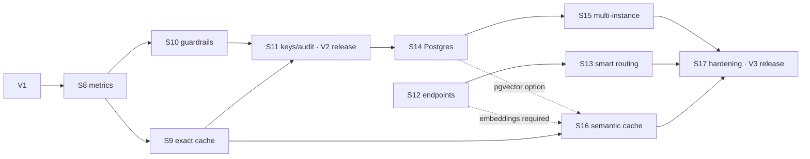

# LLM Gateway — Sprint Planning

Plan for delivering the MVP, V1, V2 and V3 described in `product.md`, following the architecture in `architecture.md`. Milestones (M0–M11) come from `product.md`; later work maps to the feature sets in `product.md` §7.7 and §10. Sprints S1–S17 are grouped here with tasks, estimates, and acceptance criteria.

The admin web app is scaffolded once in S6 and extended incrementally in every later sprint. Each sprint's UI work adds features to the same React app; there is no re-scaffolding.

## 1. Working agreement (solo, learning-focused)

| Item | Decision |
|------|----------|
| Sprint length | 2 weeks |
| Capacity | ~20 hours per sprint (side project; adjust to reality) |
| Estimation | Story points: 1 (≈1 h), 2 (≈2 h), 3 (≈half day), 5 (≈full day), 8 = too big, split it |
| Velocity assumption | ~16 points per sprint until measured; recalibrate after Sprint 2 |
| Buffer | Commit to ~16 points (80% of capacity); the task tables list full stretch scope, not commitments |
| Board | Backlog → Ready → In progress → Review (self) → Done |
| WIP limit | 2 tasks in progress at a time |
| Cadence | Sprint planning (30 min), weekly check-in (10 min), demo and retro (30 min) |

### Definition of Ready (task can start)

- Acceptance criteria are written
- Dependencies are done
- Estimate is 5 points or less

### Definition of Done (task is finished)

- Code compiles with no clippy warnings; `cargo fmt` applied
- Tests written for the new behavior and passing
- Works against the mock provider, and against a real provider where relevant
- No secrets in logs or the repo
- README or docs updated if behavior or config changed
- Merged to main via a short-lived branch (even solo; it keeps history clean)

## 2. Roadmap overview

| Sprint | Milestones | Version | Theme | Outcome |
|--------|-----------|---------|-------|---------|
| S1 | M0, M1 | MVP | Foundations | Workspace, mock provider, non-streaming passthrough |
| S2 | M2, M3 | MVP | Streaming and auth | Streaming works; virtual keys protect the API |
| S3 | M4, M5 | MVP | Observability and second provider | Usage logged; Anthropic adapter works |
| S4 | M6, M7 | V1 | Routing and resilience | Aliases, pricing, retries, fallbacks |
| S5 | M8, M9 | V1 | Control | Rate limits, budgets, admin API |
| S6 | M10 | V1 | Admin web app | React app scaffolded; onboard a project from the UI |
| S7 | M11 | V1 | Hardening and release | Tests, Docker, docs; V1 shipped |
| S8 | — | V2 | Metrics and tracing | Prometheus `/metrics`, OpenTelemetry traces, health refinements |
| S9 | — | V2 | Exact-match caching | Cache with TTL, bypass header, cost savings visible |
| S10 | — | V2 | Guardrails | PII redaction, blocked patterns, size and content rules |
| S11 | — | V2 | Key lifecycle and audit; V2 release | Key rotation, richer audit views, UI updates, v2.0.0 |
| S12 | — | V3 | More endpoints | Native `/v1/messages` and `/v1/embeddings` |
| S13 | — | V3 | Smart routing | A/B and canary routing, rule-based routing |
| S14 | — | V3 | Postgres | Pluggable storage backend with migration path |
| S15 | — | V3 | Multi-instance | Shared rate limiting, spend counters, config propagation |
| S16 | — | V3 | Semantic caching | Embedding-based cache with similarity threshold |
| S17 | — | V3 | Hardening; V3 release | Load and chaos tests, docs, v3.0.0 |

Sprint task tables list the full identified scope (22–36 pts). Commit only ~16 pts per sprint and treat the remainder as stretch or carryover, using the cut order in §5. Totals are not commitments.

**Checkpoints:** MVP end of S3; V1 end of S7; V2 end of S11; V3 end of S17.

**Entry criteria**

- **V2 (S8):** V1 released (v1.0.0 tagged), two real projects run through the gateway, S7 retro actions resolved.
- **V3 (S12):** V2 released; decide whether multi-instance is a real need or a learning exercise (affects the depth of S14–S15); run a short design spike at the start of S14 and S15.

## Part I — MVP and V1 (S1–S7)

## Sprint 1 — Foundations (M0, M1)

**Goal:** a running Rust service that forwards a non-streaming chat request to one provider and returns an OpenAI-shaped response.

**Demo:** the official OpenAI Python SDK, pointed at the gateway, gets a completion.

| # | Task | Pts | Acceptance criteria |
|---|------|-----|---------------------|
| 1.1 | Create Cargo workspace (core, providers, storage, gateway, server) | 2 | `cargo build` passes; crates follow the dependency direction |
| 1.2 | axum server with `/health` and tracing JSON logs | 2 | `GET /health` returns 200; each request logs a request ID |
| 1.3 | Config loading (TOML + env overrides) | 2 | Listen address and log level configurable without recompiling |
| 1.4 | CI: fmt, clippy, test on push | 2 | Pipeline fails on warnings |
| 1.5 | Normalized types in core (`ChatRequest`, `Message`, `ChatResponse`, `Usage`) with serde | 3 | Round-trips a real OpenAI request and response fixture |
| 1.6 | Mock provider server (configurable: ok, delay, 429, 500) | 3 | Used by integration tests; behavior chosen via a header or config |
| 1.7 | Provider trait + OpenAI-compatible adapter (non-streaming) | 3 | Adapter passes tests against the mock provider |
| 1.8 | `POST /v1/chat/completions` handler wired to the adapter | 3 | End-to-end works with the OpenAI Python SDK |
| 1.9 | OpenAI-style error mapping (`ProviderError` to JSON) | 2 | Upstream 400/429/500 produce correct status and error body |

**Total:** 22 pts (slightly over; drop 1.4 to S2 if needed)
**Learning focus:** workspaces, tokio, serde, traits and `async_trait`, Arc shared state, `thiserror`.
**Risks:** fighting the borrow checker on shared state; mitigate by keeping state Arc-wrapped and immutable.

## Sprint 2 — Streaming and auth (M2, M3)

**Goal:** streaming works correctly, including cancellation, and every request requires a valid virtual key.

**Demo:** a streamed completion arrives token by token in the SDK; killing the client stops the upstream call; a revoked key gets 401.

| # | Task | Pts | Acceptance criteria |
|---|------|-----|---------------------|
| 2.1 | Add `chat_stream` to the Provider trait returning a `BoxStream` of `ChatChunk` | 3 | Compiles for the OpenAI adapter |
| 2.2 | SSE parser for upstream responses (handles partial frames across chunk boundaries) | 5 | Passes tests with fragmented, multi-event, and malformed input |
| 2.3 | Re-emit chunks as OpenAI SSE, ending with `[DONE]` | 3 | SDK streaming works; no full buffering |
| 2.4 | Cancel upstream when client disconnects | 3 | Test: client abort stops the mock provider's stream within a short time |
| 2.5 | Mid-stream error handling (final SSE error event) | 2 | Mock cuts the stream; client receives a clear error |
| 2.6 | SQLite + sqlx setup, migrations: `projects`, `api_keys` | 3 | `sqlx migrate run` works; WAL mode enabled |
| 2.7 | Key generation and hashing (`gw-<random>`, SHA-256, display prefix) | 2 | Secret shown once; only the hash is stored |
| 2.8 | Auth middleware (tower layer) attaching `AuthContext` | 3 | Missing, invalid, and revoked keys return 401 with the correct error body |
| 2.9 | CLI: `gateway key create/revoke/list --project` | 2 | Usable from the terminal against the DB |

**Total:** 26 pts (stretch; prioritize 2.1–2.5 first, 2.6–2.9 can spill to S3)
**Learning focus:** `futures::Stream`, backpressure, drop semantics for cancellation, sqlx, tower layers.
**Risks:** SSE edge cases; cancellation correctness. Write the failing tests first.

## Sprint 3 — Usage logging and second provider (M4, M5)

**Goal:** every request is recorded without slowing the hot path, and a second provider works behind the same API.

MVP checkpoint reached at the end of this sprint.

**Demo:** the same client code calls both an OpenAI and an Anthropic model; SQL shows tokens, latency, and TTFT for each call.

| # | Task | Pts | Acceptance criteria |
|---|------|-----|---------------------|
| 3.1 | `requests` table and indexes | 2 | Migration applied; schema matches the architecture doc |
| 3.2 | `UsageEvent` type and bounded mpsc channel with `try_send` | 2 | Handlers never block on logging |
| 3.3 | Background batch writer (N events or T ms per transaction) | 3 | Rows appear after a short delay; failures logged, never propagated |
| 3.4 | Stream tap: TTFT, final usage, emits on end or drop | 5 | Cancelled streams are logged with `client_cancelled` |
| 3.5 | Graceful shutdown that drains in-flight requests and the log channel | 3 | No lost events on SIGTERM in a test |
| 3.6 | Anthropic adapter: request mapping (system prompt, required `max_tokens`, roles) | 5 | Non-streaming call works against the real API |
| 3.7 | Anthropic streaming event translation to `ChatChunk` | 5 | Streaming works through the same OpenAI-format endpoint |
| 3.8 | Tool-call mapping between formats | 3 | A tool-calling round trip works on both providers |
| 3.9 | Provider selection by model name (temporary, replaced by aliases in S4) | 1 | Request for a Claude model goes to Anthropic |

**Total:** 29 pts (heavy; 3.8 is the first candidate to defer)
**Learning focus:** channels and background tasks, `Drop` for cleanup, where abstractions leak.
**Risks:** provider format differences, especially streaming and tools. Keep recorded fixtures of real payloads.

## Sprint 4 — Routing and resilience (M6, M7)

**Goal:** projects use aliases, costs are computed, and provider failures are handled automatically.

**Demo:** remap `smart` to another model in the DB and see it take effect; kill the primary mock provider and watch the fallback serve the request with the attempt chain logged.

| # | Task | Pts | Acceptance criteria |
|---|------|-----|---------------------|
| 4.1 | Tables: `providers`, `models`, `aliases`, `alias_targets`, `key_allowed_aliases` | 3 | Migrations applied, seed script for dev |
| 4.2 | In-memory `ConfigSnapshot` behind ArcSwap with reload function | 3 | Reads are lock-free; reload swaps atomically |
| 4.3 | Alias resolution in the request path; unknown alias returns 404 | 3 | Replaces the temporary model-name routing |
| 4.4 | Per-key alias allowlist enforcement | 2 | Disallowed alias returns 403 |
| 4.5 | Pricing per model and cost calculation stored on each request | 3 | Cost matches a hand-computed example; price at request time is stored |
| 4.6 | Retry with exponential backoff and jitter, honoring `Retry-After` | 3 | Only retryable errors retried; non-retryable returned immediately |
| 4.7 | Fallback chain execution, recording each attempt (`attempts_json`) | 3 | Mock 500s trigger fallback; log shows all attempts |
| 4.8 | Streaming rule: retry/fallback only before the first chunk | 3 | Mid-stream failure is not retried |
| 4.9 | Per-route timeouts | 2 | Slow mock triggers timeout then fallback |
| 4.10 | Circuit breaker per provider (closed, open, half-open) | 3 | Failing provider is skipped, then probed after cooldown |

**Total:** 28 pts (stretch; 4.10 can slip to S5 or V2)
**Learning focus:** ArcSwap, state machines, designing for failure, tower retry and timeout concepts.
**Risks:** subtle retry semantics. Drive everything through mock-provider scenario tests.

## Sprint 5 — Control (M8, M9)

**Goal:** limits and budgets are enforced, and everything is manageable through a secured admin API.

**Demo:** exceed a rate limit and a budget and see correct 429s; create a project and key with curl against the admin API.

| # | Task | Pts | Acceptance criteria |
|---|------|-----|---------------------|
| 5.1 | Token-bucket rate limiter per key (requests/min) | 3 | Excess requests get 429 with `Retry-After` |
| 5.2 | Tokens-per-minute limiting (post-hoc accounting) | 3 | Documented behavior for streaming and estimation |
| 5.3 | In-memory month-to-date spend counters, rebuilt at startup, updated at request completion (not by the log writer) | 3 | Counters match a SQL sum of the logs; dropping log events does not change enforcement |
| 5.4 | Budget enforcement middleware | 2 | Over-budget project gets `budget_exceeded` |
| 5.5 | Separate admin router and listener | 2 | Admin port is independent of the data-plane port |
| 5.6 | `admin_users`, password hashing (Argon2), login with HttpOnly SameSite=Strict session cookie | 5 | Bootstrap admin from env; wrong password rejected; login throttled; no tokens in localStorage |
| 5.7 | Admin CRUD: projects, keys (secret once), providers, models, aliases, pricing, limits | 5 | Each mutation reloads the config snapshot |
| 5.8 | Provider credentials encrypted at rest (master key from env) | 3 | DB dump contains no plaintext provider keys |
| 5.9 | Usage query endpoints (totals and time series) | 3 | Filter by project, model, alias, tag, range |
| 5.10 | Audit log for admin mutations | 2 | Every write produces an audit row |
| 5.11 | OpenAPI spec (`utoipa`) and CI drift check for the generated client | 2 | Spec served and valid; regenerated client matches the committed one in CI |

**Total:** 33 pts (too much for one sprint; carry 5.10 into S6. 5.11 must land in S5 because S6's generated client depends on it)
**Learning focus:** concurrency-safe counters, authentication design, encryption at rest, API design.
**Risks:** scope. This is the largest sprint; cut 5.2 or 5.10 first — never 5.11.

## Sprint 6 — Admin web app (M10)

**Goal:** a new project can be onboarded end to end from the UI.

**Demo:** log in, create a project and a key, set an alias with a fallback, set a budget, call the gateway with the new key, and see the usage appear on the dashboard.

Stack decided and frozen: Vite + React + TypeScript SPA, TanStack Router and Query, shadcn/ui + Tailwind, React Hook Form + Zod, Recharts, TanStack Table, Vitest/RTL and Playwright. Details in `architecture.md` §7. The UI is served by the Rust admin listener on 8081.

| # | Task | Pts | Acceptance criteria |
|---|------|-----|---------------------|
| 6.1 | Vite + React + TS setup, generated API client, login and session handling | 3 | Unauthenticated users redirected to login; client generated from the OpenAPI spec; CI drift check fails on a stale client |
| 6.2 | Projects and keys page (create, revoke, copy-once secret) | 5 | Secret visible only at creation |
| 6.3 | Aliases and fallback chain editor | 5 | Reorder targets; changes apply immediately |
| 6.4 | Providers and models pages (including pricing) | 3 | Test-connection button works |
| 6.5 | Limits and budgets editor | 2 | Edits reflected in enforcement |
| 6.6 | Dashboard: requests, tokens, cost, latency, error rate over time | 5 | Charts match SQL for a known dataset |
| 6.7 | Request log table with filters and detail view | 5 | Filter by project, model, status, tag, time |
| 6.8 | Playground to test an alias | 3 | Streams a response from the gateway |
| 6.9 | Serve built static assets from the Rust admin listener (`ServeDir`) | 2 | Same-origin requests on 8081; no CORS; one container |
| 6.10 | Playwright smoke test: login, create project/key, dashboard | 3 | Runs in CI against the built app |

**Total:** 36 pts (cut 6.8 first, then simplify 6.6; 5.11 must be done in S5)
**Learning focus:** the API as a product surface; keep UI minimal and functional.
**Risks:** frontend polish consuming the sprint. Functional over pretty.

## Sprint 7 — Hardening and release (M11)

**Goal:** reliable, documented, and reproducible. Ship V1.

**Demo:** from a fresh clone, `docker compose up` yields a working gateway and admin app; two real projects run through it.

| # | Task | Pts | Acceptance criteria |
|---|------|-----|---------------------|
| 7.1 | Integration suite using the mock provider: success, slow, 429, 500, mid-stream cut, malformed SSE | 5 | Runs in CI in reasonable time |
| 7.2 | Contract tests with OpenAI Python and TS SDKs (including streaming and errors) | 3 | Both SDKs pass |
| 7.3 | Load test: concurrent streams and client-disconnect storms | 3 | No leaks or stuck tasks; results recorded |
| 7.4 | Multi-stage Dockerfile (Vite build + Rust binary), docker-compose, Caddy example | 3 | Fresh-clone setup works; one container serves the admin API and built UI |
| 7.5 | Backup and restore procedure for SQLite | 2 | Documented and tested once |
| 7.6 | Log retention and cleanup job | 2 | Old rows pruned on schedule |
| 7.7 | README, client examples (Python, TS, curl), configuration reference | 3 | A new reader can run it in under 15 minutes |
| 7.8 | Migrate two real projects to the gateway | 3 | Both work with only `base_url` and `api_key` changed |
| 7.9 | Release v1.0.0 tag, changelog, retro, V2 backlog grooming | 2 | Tag pushed |

**Total:** 26 pts
**Learning focus:** testing async systems, deployment, operational thinking.

## Part II — V2 (S8–S11)

## Sprint 8 — Metrics and tracing

**Goal:** the gateway is observable by standard tooling, not just by querying SQLite.

**Demo:** a Grafana dashboard (or raw `/metrics` output) shows request rate, latency percentiles, and errors per provider; a trace shows a request with its retry and fallback attempts as child spans.

| # | Task | Pts | Acceptance criteria |
|---|------|-----|---------------------|
| 8.1 | Metrics crate setup and `/metrics` endpoint (on the admin listener) | 3 | Prometheus format; not exposed on the public data-plane port |
| 8.2 | Core metrics: request count, latency histogram, TTFT histogram, tokens, cost, in-flight requests | 5 | Labels limited to low-cardinality values (project, alias, provider, status) |
| 8.3 | Upstream metrics: errors by provider and kind, retries, fallbacks, circuit-breaker state | 3 | Matches the attempt data in the request log |
| 8.4 | Operational metrics: log channel depth, dropped usage events, DB write latency | 2 | Dropped events visible on a counter |
| 8.5 | OpenTelemetry tracing: root span per request, child span per upstream attempt | 5 | Spans carry project, alias, provider, model, status; no prompt content |
| 8.6 | OTLP exporter configurable via env; disabled by default | 2 | No overhead when disabled |
| 8.7 | Sampling configuration (always sample errors, probabilistic for success) | 2 | Configurable ratio |
| 8.8 | Starter Grafana dashboard JSON and docker-compose observability profile | 3 | One command brings up Prometheus and Grafana with the dashboard |
| 8.9 | Refine `/ready`: DB check, config loaded, at least one healthy provider | 1 | Returns 503 with a reason when not ready |
| 8.10 | Admin UI: metrics link and health/status panel | 2 | Links to the dashboard; extends the existing React app |

**Total:** 28 pts (cut 8.8 or 8.7 if behind)
**Learning focus:** metric design and cardinality, OpenTelemetry in Rust, correlating logs, metrics, and traces.
**Risks:** label cardinality explosions (never label by key ID, request ID, or raw model input).

## Sprint 9 — Exact-match caching

**Goal:** identical requests can be served from cache, with clear controls and visible savings.

**Demo:** the same request sent twice, where the second returns instantly and is logged as a cache hit with $0 cost and the saved cost recorded.

| # | Task | Pts | Acceptance criteria |
|---|------|-----|---------------------|
| 9.1 | Cache key design: hash of normalized request (alias, messages, params, tools); project scoped by default | 3 | Documented; semantically equal requests normalize to the same key |
| 9.2 | Cache storage trait with in-memory (`moka`) implementation | 3 | Size and TTL bounds; eviction works |
| 9.3 | Cache layer in the request path (non-streaming) | 3 | Hit skips the provider and returns the stored response |
| 9.4 | Streaming cache support: store the assembled response and replay it as an SSE stream | 5 | Replayed stream is indistinguishable to the SDK |
| 9.5 | Controls: per-alias enable and TTL, `X-Gateway-Cache: bypass` and `no-store` headers | 3 | Honored and tested |
| 9.6 | Never-cache rules: errors, truncated or cancelled streams, requests with high temperature (configurable), tool-calling when disabled | 3 | Test per rule |
| 9.7 | Log fields: `cache_status` (hit, miss, bypass), `saved_cost_usd` | 2 | Migration applied; visible in the request log |
| 9.8 | Metrics: hit ratio, saved cost | 2 | Exposed on `/metrics` |
| 9.9 | Admin API and UI: cache settings per alias, purge by alias or project | 3 | Purge takes effect immediately; UI extends the existing React app |

**Total:** 27 pts (stretch; 9.4 is the riskiest, 9.9 can slip)
**Learning focus:** cache key normalization, correctness vs. hit rate, replaying streams.
**Risks:** serving stale or cross-project data. Cache keys include the project by default; shared caching must be an explicit opt-in.

## Sprint 10 — Guardrails

**Goal:** configurable protections applied before requests reach providers and before sensitive data reaches logs.

**Demo:** a prompt containing an email and a card number is redacted in logs (and optionally in the upstream request); a request matching a blocked pattern is rejected with a clear error.

| # | Task | Pts | Acceptance criteria |
|---|------|-----|---------------------|
| 10.1 | Guardrail pipeline abstraction: ordered stages with Allow, Modify, Reject outcomes | 3 | Pipeline unit-tested independently of HTTP |
| 10.2 | Input size and structure checks (max messages, max prompt chars, allowed roles) | 2 | Rejects with a 400 and a specific error code |
| 10.3 | Regex blocklist and allowlist rules per project | 3 | Rules editable via the admin API |
| 10.4 | PII detector: emails, phone numbers, credit cards (Luhn check), common ID formats | 5 | Test corpus with true and false positives documented |
| 10.5 | Redaction modes: log-only redaction vs. redact before sending upstream | 3 | Configurable per project; default is log-only |
| 10.6 | Response-side checks (blocked patterns, redact in logs) | 3 | Streaming responses handled with a rolling buffer |
| 10.7 | Optional external moderation hook (HTTP call, with timeout and fail-open or fail-closed setting) | 3 | Failure mode configurable and tested |
| 10.8 | Guardrail decisions recorded in the request log (`guardrail_action`, `rule_id`) | 2 | Never store the matched sensitive content |
| 10.9 | Admin UI: rules editor and a test box ("would this input be blocked?") | 3 | Dry-run endpoint backing the test box; UI extends the existing React app |

**Total:** 27 pts (cut 10.7, then 10.6, if behind)
**Learning focus:** composable pipelines, streaming text scanning across chunk boundaries, false-positive trade-offs.
**Risks:** latency added on the hot path, and patterns split across stream chunks. Budget a per-stage latency limit and benchmark.

## Sprint 11 — Key lifecycle, audit, and V2 release

**Goal:** safe key management and a complete audit trail; ship V2.

**Demo:** rotate a project key with an overlap window so the old key keeps working briefly, then stops; filter the audit log by admin and action.

| # | Task | Pts | Acceptance criteria |
|---|------|-----|---------------------|
| 11.1 | Key rotation: create a successor key, keep the old one valid until a set expiry | 5 | Overlap window configurable; old key rejected afterward |
| 11.2 | Last-used tracking per key (batched, not per request writes) | 2 | Visible in the admin UI without slowing the hot path |
| 11.3 | Key expiry reminders: list of keys expiring soon, optional webhook | 2 | Endpoint and UI badge |
| 11.4 | Scoped admin roles (admin, read-only) enforced across endpoints | 3 | Read-only cannot mutate; tested |
| 11.5 | Audit log views: filter by admin, action, target, time; diff of config changes | 3 | Before and after values stored for mutations |
| 11.6 | Budget alerts: webhook or email at 80% and 100% thresholds | 3 | Fires once per threshold per period |
| 11.7 | Admin UI updates for everything shipped in V2 | 5 | Metrics link, cache, guardrails, keys, audit; extends the existing React app |
| 11.8 | V2 regression pass: integration, contract, and load tests re-run | 3 | No V1 behavior regressions |
| 11.9 | Docs, changelog, migration notes, v2.0.0 tag, retro | 2 | Upgrade from V1 documented and tested |

**Total:** 28 pts (cut 11.3 first)
**Learning focus:** zero-downtime credential rotation, access control, change auditing.

## Part III — V3 (S12–S17)

## Sprint 12 — More endpoints: `/v1/messages` and `/v1/embeddings`

**Goal:** clients using the Anthropic SDK and embedding workloads can use the gateway.

**Demo:** the official Anthropic SDK, with its base URL pointed at the gateway, completes a request (including streaming); an embeddings call works through an alias.

| # | Task | Pts | Acceptance criteria |
|---|------|-----|---------------------|
| 12.1 | Anthropic-format request and response types in core | 3 | Round-trips real fixtures |
| 12.2 | `POST /v1/messages` route translating to the internal `ChatRequest` and back | 5 | Same auth, limits, routing, logging as the OpenAI route |
| 12.3 | Anthropic-format streaming events emitted from internal chunks | 5 | Anthropic SDK streaming works |
| 12.4 | Tool use and system prompt handling in the Anthropic format; routing an Anthropic-format request to an OpenAI model and vice versa | 5 | Cross-provider translation tested both directions |
| 12.5 | Embeddings types, `Provider::embed`, OpenAI adapter | 3 | Batch inputs supported |
| 12.6 | `POST /v1/embeddings` with alias resolution, limits, cost (input tokens only) | 3 | Logged with the correct cost |
| 12.7 | Embedding model aliases and pricing in the admin UI | 2 | Distinguished from chat aliases; extends the existing React app |
| 12.8 | Contract tests with the Anthropic SDK | 2 | Passes in CI |

**Total:** 28 pts (cut 12.4 cross-provider translation if needed, keeping same-format routing)
**Learning focus:** protocol translation, keeping one internal representation, API compatibility testing.
**Risks:** fidelity loss in translation (cache control, thinking blocks). Document unsupported fields explicitly and pass them through where the target supports them.

## Sprint 13 — Smart routing: A/B, canary, and rules

**Goal:** route traffic by policy instead of just by fallback order.

**Demo:** send 10% of `smart` traffic to a candidate model, compare latency, cost, and error rate per variant on the dashboard, then adjust the weight from the admin UI.

| # | Task | Pts | Acceptance criteria |
|---|------|-----|---------------------|
| 13.1 | Routing policy model: weighted targets per alias (replacing or extending ordered chains) | 5 | Backward compatible with V1/V2 aliases |
| 13.2 | Deterministic weighted selection (sticky by project, key, or a request header) | 3 | Same user stays in the same variant when sticky is enabled |
| 13.3 | Rule-based routing: by project, tag header, prompt size, or time window | 5 | Rules evaluated in order; first match wins; tested |
| 13.4 | Canary controls: percentage, auto-halt on error-rate threshold | 5 | Halts and alerts when the threshold is crossed |
| 13.5 | Variant labeling in logs and metrics (`route_variant`) | 2 | Filterable in the log viewer |
| 13.6 | Comparison endpoint: latency, cost, error rate, token usage by variant | 3 | Supports the demo dashboard |
| 13.7 | Admin UI: weights editor, rules editor, variant comparison view | 5 | Changes apply without restart; extends the existing React app |

**Total:** 28 pts (cut 13.4 auto-halt first)
**Learning focus:** policy design, consistent hashing, safe rollout practices.
**Risks:** interactions between caching, fallbacks, and variants. Define precedence (rules, then weights, then fallback) and include the variant in the cache key.

## Sprint 14 — Postgres support

**Goal:** run on Postgres without behavior changes, with a path to migrate from SQLite.

Design spike (first 2 days): choose between sqlx with runtime backend selection (via `Any` or feature flags) vs. a repository trait with two implementations. Recommendation: repository traits in storage with separate SQLite and Postgres implementations behind feature flags.

**Demo:** the full integration suite passes on both backends; a SQLite database is migrated into Postgres with a verification report.

| # | Task | Pts | Acceptance criteria |
|---|------|-----|---------------------|
| 14.1 | Spike: backend strategy decision, documented | 2 | Short ADR written |
| 14.2 | Refactor storage into repository traits | 5 | No SQL leaks outside the storage crate |
| 14.3 | Postgres migrations equivalent to SQLite schema (types, indexes, JSON columns) | 5 | Schema parity documented |
| 14.4 | Postgres repository implementations | 5 | Passes the repository test suite |
| 14.5 | Run the full integration test suite against both backends in CI | 3 | Matrix build |
| 14.6 | Time-series queries and indexes tuned for Postgres (consider partitioning `requests` by month) | 3 | Dashboard queries within target latency on a large dataset |
| 14.7 | SQLite to Postgres migration tool with row counts and checksum verification | 5 | Dry-run mode; idempotent |
| 14.8 | Connection pool settings, timeouts, and failure handling | 2 | Degraded DB does not crash the data plane |

**Total:** 30 pts (stretch; cut 14.6 partitioning if behind)
**Learning focus:** abstraction boundaries over a database, data migration, query tuning.
**Risks:** subtle behavioral differences (types, transactions, timestamps). Share one test suite across both backends.

## Sprint 15 — Multi-instance

**Goal:** two or more gateway instances behave as one logical gateway.

Design spike (first 2 days): decide the shared state store. Recommendation: Redis for rate limits, spend counters, and circuit-breaker hints; Postgres as the source of truth for config and logs; config propagation through Postgres `LISTEN/NOTIFY` or a version poll.

**Demo:** two instances behind a load balancer; a rate limit set at 60 requests per minute holds across both; a config change in the admin UI reaches both within seconds; killing one instance causes no outage.

| # | Task | Pts | Acceptance criteria |
|---|------|-----|---------------------|
| 15.1 | Spike: shared-state design and ADR | 2 | Covers consistency trade-offs for limits and budgets |
| 15.2 | Distributed rate limiter (Redis, atomic Lua script or equivalent) | 5 | Limit holds within an agreed tolerance across instances |
| 15.3 | Shared spend counters with periodic reconciliation against the log | 5 | Budget enforcement correct within tolerance; drift is corrected |
| 15.4 | Config propagation: version check or `LISTEN/NOTIFY`, atomic snapshot swap on each instance | 5 | Changes visible on all instances within seconds |
| 15.5 | Cache backend option: shared (Redis) vs. per-instance | 3 | Configurable; metrics show hit ratio |
| 15.6 | Circuit-breaker state sharing or independent-with-hints decision | 2 | Documented behavior |
| 15.7 | Instance identity in logs, metrics, and traces | 2 | `instance_id` label |
| 15.8 | Graceful drain for rolling deploys (readiness flips before shutdown) | 3 | No dropped streams in a rolling restart test |
| 15.9 | Multi-instance docker-compose with a load balancer; failure tests | 3 | Instance kill and Redis outage scenarios documented |

**Total:** 30 pts (cut 15.5 and 15.6 if behind)
**Learning focus:** distributed state, consistency vs. availability, designing for partial failure.
**Risks:** Redis becoming a single point of failure. Define fail-open vs. fail-closed behavior per feature and test it.

## Sprint 16 — Semantic caching

**Goal:** near-duplicate prompts hit the cache based on embedding similarity, safely.

**Demo:** two differently worded versions of the same question hit the same cached answer; a deliberately different question misses; the dashboard shows precision and savings.

| # | Task | Pts | Acceptance criteria |
|---|------|-----|---------------------|
| 16.1 | Embedding pipeline for cache lookups using the embeddings endpoint (alias configurable) | 3 | Cost and latency of embedding tracked separately |
| 16.2 | Vector storage and search: start with pgvector or an in-memory index (HNSW) | 5 | Lookup latency target defined and measured |
| 16.3 | Similarity threshold configuration per alias | 2 | Editable; default is conservative |
| 16.4 | Safety scoping: project isolation, system-prompt and parameter equality required, tool-call requests excluded | 3 | Test cases where similar text must not match |
| 16.5 | Semantic cache layer in the pipeline after exact cache | 3 | Exact first, semantic second, provider last |
| 16.6 | Hit validation sampling: periodically call the provider on a hit and compare, to estimate wrong-hit rate | 5 | Shadow evaluation recorded in metrics |
| 16.7 | Cache poisoning and eviction rules (TTL, size, manual purge) | 2 | Purge by alias works |
| 16.8 | Admin UI: threshold tuning, hit examples, savings and quality metrics | 5 | Reviewer can inspect matched pairs; extends the existing React app |

**Total:** 28 pts (cut 16.6 or reduce 16.8 if behind)
**Learning focus:** vector search, precision vs. recall in caching, evaluating a heuristic with data.
**Risks:** wrong cache hits returning irrelevant answers. Keep it opt-in per alias, default threshold high, and measure the wrong-hit rate before enabling widely.

## Sprint 17 — Hardening and V3 release

**Goal:** confidence at scale and a clean release.

**Demo:** a recorded load test with chaos events (provider outage, Redis outage, DB failover, instance kill) and a summary of how the gateway behaved.

| # | Task | Pts | Acceptance criteria |
|---|------|-----|---------------------|
| 17.1 | Load test suite at higher concurrency including streaming, cache hits, and mixed routing | 5 | Baseline numbers recorded in docs |
| 17.2 | Chaos scenarios: provider failures, Redis down, Postgres slow, instance loss | 5 | Documented outcome per scenario; fixes for any defects found |
| 17.3 | Security review: keys, secrets handling, admin plane exposure, dependency audit (`cargo audit`, `cargo deny`) | 3 | Findings triaged |
| 17.4 | Performance profiling and fixes (flamegraphs, allocation hotspots) | 5 | Documented before and after |
| 17.5 | Upgrade and migration guide (V2 to V3, SQLite to Postgres, single to multi-instance) | 3 | Tested end to end once |
| 17.6 | Documentation refresh: architecture, product, ops runbook | 3 | Matches what shipped |
| 17.7 | Release v3.0.0, changelog, retro, next-horizon backlog | 2 | Tag pushed |

**Total:** 26 pts

## 3. Dependencies and critical path

MVP and V1 (S1–S7):


- The mock provider (1.6) blocks nearly all later testing. Do it early.
- Streaming (S2) is the riskiest technical area; front-loading it exposes problems early.
- Aliases (S4) depend on auth and logging being in place.
- The admin API (S5) must precede the UI (S6).
- The OpenAPI spec (5.11) is a hard dependency for S6: the React client is generated from it and CI checks for drift. Do not cut it.

V2 and V3 (S8–S17):



- Metrics (S8) first: later sprints benefit from being measurable (cache hit ratio, variant comparison, multi-instance behavior).
- Exact cache (S9) precedes semantic cache (S16); embeddings (S12) are required before semantic caching (S16).
- Postgres (S14) precedes multi-instance (S15) and enables pgvector for S16.
- S12 and S13 are independent of S14–S15 and can be swapped in order if priorities change.
- The React app is scaffolded once in S6. Every later UI task depends only on the API shipped earlier in that sprint and extends the same app.

## 4. Risk register

MVP and V1:

| Risk | Likelihood | Impact | Mitigation |
|------|-----------|--------|------------|
| Rust learning curve slows early sprints | High | Medium | Plan to 80% capacity; re-estimate after S2 |
| Provider format differences (streaming, tools) | High | Medium | Recorded fixtures; defer tool mapping if needed |
| Streaming cancellation and cleanup bugs | Medium | High | Dedicated tests from the start; verify with the mock |
| SQLite write contention | Low | Medium | WAL mode; single batched writer |
| Scope creep from the V2/V3 plan | Medium | High | Backlog is closed until V1 ships |
| S5 and S6 overloaded (admin API and React app) | High | Medium | Pre-agreed cut list (below) |
| Real provider API costs during testing | Low | Low | Use the mock by default; small prompts for real-provider runs |
| Motivation drop mid-project | Medium | High | Every sprint ends with a demo; keep sprints shippable |

V2 and V3:

| Risk | Likelihood | Impact | Mitigation |
|------|-----------|--------|------------|
| Cache serving wrong or cross-project data | Medium | High | Project-scoped keys by default; opt-in sharing; purge tools; shadow validation for semantic cache |
| Guardrail latency or false positives hurt UX | Medium | Medium | Per-stage latency budgets; dry-run testing; log-only default |
| Metric label cardinality explosion | Medium | Medium | Review labels in code review; no ID-like labels |
| Translation fidelity between API formats | High | Medium | Document gaps; pass through unknown fields; contract tests |
| Postgres port introduces behavioral drift | Medium | Medium | One shared test suite across backends; migration verification |
| Distributed rate limiting complexity | High | Medium | Accept approximate limits; document tolerances; define fail-open/closed |
| Scope creep and motivation loss over 10 more sprints | High | High | Each sprint has a demo; V2 is a valid stopping point; reassess before S12 |
| Real costs from provider calls (embeddings, validation sampling) | Medium | Low | Mock by default; cap sampling rates |

## 5. Scope-cut order (when behind)

Cut in this order without breaking the MVP or the core value of the current version. UI work is incremental on the same React app; cut a feature's UI only with that feature.

1. **MVP/V1:** playground (6.8), circuit breaker (4.10), tokens-per-minute limits (5.2), tool-call mapping (3.8), dashboard polish (6.6) and audit log UI.
2. **V2:** Grafana dashboard (8.8), budget alert delivery channels (11.6), key expiry reminders (11.3), external moderation hook (10.7).
3. **V3:** cross-provider translation (12.4), auto-halt canary (13.4), table partitioning (14.6), shared cache backend (15.5), shadow validation (16.6).

**Never cut:** streaming correctness, key hashing, provider-credential encryption, usage logging, fallback logic, the OpenAPI spec (5.11) and generated client, project isolation in caches, redaction defaults that keep sensitive data out of logs, key-rotation overlap logic, migration verification.

## 6. Reassessment gates

- **End of S7 (V1 release):** Are two real projects using the gateway, and are the retro action items resolved before V2 entry?
- **End of S11 (V2 release):** Is the gateway meeting real needs? Are V3 features still valuable, or has the learning goal shifted (for example toward evals or agent infrastructure)? Continue, reorder, or stop.
- **Start of S14:** Is multi-instance a real requirement? If not, keep SQLite, skip S14–S15, and move semantic caching (S16) to an in-memory index.
- **Start of S16:** Is the exact-cache hit rate low enough to justify semantic caching? Use S9 metrics to decide.

## 7. Decisions

| Decision | Needed by | Options | Status |
|----------|-----------|---------|--------|
| Admin UI stack | S6 | React SPA vs. askama + HTMX | Decided: Vite + React + TS SPA served from the admin listener |
| Admin auth | S5 | Cookie session vs. bearer token | Decided: HttpOnly, SameSite=Strict session cookie |
| Default logging mode | S3 | Off / metadata (recommended) / full | Open |
| Hosting target for the first real deployment | S7 | Local Docker vs. small VPS vs. Fly.io | Open |
| Metrics label set | S8 | Minimal vs. extended | Open |
| Cache default scope | S9 | Per project (recommended) vs. global | Open |
| Redaction default | S10 | Log-only (recommended) vs. upstream too | Open |
| Postgres strategy | S14 | Repository traits vs. runtime-selected sqlx backend | Open |
| Shared state store | S15 | Redis vs. Postgres only | Open |
| Vector index | S16 | pgvector vs. in-memory HNSW | Open |

## 8. Sprint ceremonies (lightweight, solo)

**Planning (30 min)**

- Review the previous sprint's velocity
- Pick tasks up to ~80% of capacity
- Confirm each has acceptance criteria and a point estimate

**Weekly check-in (10 min)**

- What is blocked? What is slipping? Cut now, not at the end.

**Demo (15 min)**

- Run the sprint's demo scenario live and record a short screen capture or notes.

**Retro (15 min)**

- What did I learn in Rust this sprint?
- What took longer than estimated, and why?
- What one process change do I make next sprint?

## 9. Tracking template

```markdown
## Sprint N — <goal>
Dates: YYYY-MM-DD → YYYY-MM-DD
Version: MVP | V1 | V2 | V3
Planned: __ pts | Completed: __ pts | Velocity: __

### Done
- [x] N.1 ...

### Carried over
- [ ] N.x ... (reason)

### Demo
<what was shown, link to capture>

### Decisions made
<link to ADR or note>

### Retro
- Learned:
- Slower than expected:
- Change for next sprint:
```

## 10. Beyond V3 (not scheduled)

No work is scheduled past V3. Decide at the S17 reassessment gate what comes next, using §6.
