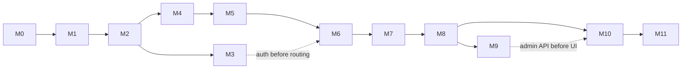

# LLM Gateway — Sprint Planning

Plan for delivering the MVP and V1 described in `product.md`, following the architecture in `architecture.md`. Milestones (M0–M11) come from the build plan; here they are grouped into sprints with tasks, estimates, and acceptance criteria.

## 1. Working agreement (solo, learning-focused)

| Item | Decision |
|------|----------|
| Sprint length | 2 weeks |
| Capacity | ~20 hours per sprint (side project; adjust to reality) |
| Estimation | Story points: 1 (≈1 h), 2 (≈2 h), 3 (≈half day), 5 (≈full day), 8 = too big, split it |
| Velocity assumption | ~20 points per sprint until measured; recalibrate after Sprint 2 |
| Buffer | Plan to ~80% of capacity (16 points); learning Rust takes longer than coding it |
| Board | Backlog → Ready → In progress → Review (self) → Done |
| WIP limit | 2 tasks in progress at a time |
| Cadence | Sprint planning (30 min), weekly check-in (10 min), demo and retro (30 min) |

### Definition of Ready (task can start)

- Acceptance criteria are written
- Dependencies are done
- Estimate is 5 points or less

### Definition of Done (task is finished)

- Code compiles with no clippy warnings; `cargo fmt` applied
- Tests written for the new behavior and passing
- Works against the mock provider, and against a real provider where relevant
- No secrets in logs or the repo
- README or docs updated if behavior or config changed
- Merged to main via a short-lived branch (even solo; it keeps history clean)

## 2. Roadmap overview

| Sprint | Milestones | Theme | Outcome |
|--------|-----------|-------|---------|
| S1 | M0, M1 | Foundations | Workspace, mock provider, non-streaming passthrough |
| S2 | M2, M3 | Streaming and auth | Streaming works; virtual keys protect the API |
| S3 | M4, M5 | Observability and second provider | Usage logged; Anthropic adapter works |
| S4 | M6, M7 | Routing and resilience | Aliases, pricing, retries, fallbacks |
| S5 | M8, M9 | Control | Rate limits, budgets, admin API |
| S6 | M10 | Admin web app | Onboard a project from the UI |
| S7 | M11 | Hardening and release | Tests, Docker, docs; V1 shipped |

**MVP checkpoint** (end of S3): one project can use the gateway with its own key, on two providers, with usage visible in SQL.
**V1 checkpoint** (end of S7): everything in the product doc's V1 scope.

## Sprint 1 — Foundations (M0, M1)

**Goal:** a running Rust service that forwards a non-streaming chat request to one provider and returns an OpenAI-shaped response.

**Demo:** the official OpenAI Python SDK, pointed at the gateway, gets a completion.

| # | Task | Pts | Acceptance criteria |
|---|------|-----|---------------------|
| 1.1 | Create Cargo workspace (core, providers, storage, gateway, server) | 2 | `cargo build` passes; crates follow the dependency direction |
| 1.2 | axum server with `/health` and tracing JSON logs | 2 | `GET /health` returns 200; each request logs a request ID |
| 1.3 | Config loading (TOML + env overrides) | 2 | Listen address and log level configurable without recompiling |
| 1.4 | CI: fmt, clippy, test on push | 2 | Pipeline fails on warnings |
| 1.5 | Normalized types in core (`ChatRequest`, `Message`, `ChatResponse`, `Usage`) with serde | 3 | Round-trips a real OpenAI request and response fixture |
| 1.6 | Mock provider server (configurable: ok, delay, 429, 500) | 3 | Used by integration tests; behavior chosen via a header or config |
| 1.7 | Provider trait + OpenAI-compatible adapter (non-streaming) | 3 | Adapter passes tests against the mock provider |
| 1.8 | `POST /v1/chat/completions` handler wired to the adapter | 3 | End-to-end works with the OpenAI Python SDK |
| 1.9 | OpenAI-style error mapping (`ProviderError` to JSON) | 2 | Upstream 400/429/500 produce correct status and error body |

**Total:** 22 pts (slightly over; drop 1.4 to S2 if needed)
**Learning focus:** workspaces, tokio, serde, traits and `async_trait`, Arc shared state, `thiserror`.
**Risks:** fighting the borrow checker on shared state; mitigate by keeping state Arc-wrapped and immutable.

## Sprint 2 — Streaming and auth (M2, M3)

**Goal:** streaming works correctly, including cancellation, and every request requires a valid virtual key.

**Demo:** a streamed completion arrives token by token in the SDK; killing the client stops the upstream call; a revoked key gets 401.

| # | Task | Pts | Acceptance criteria |
|---|------|-----|---------------------|
| 2.1 | Add `chat_stream` to the Provider trait returning a `BoxStream` of `ChatChunk` | 3 | Compiles for the OpenAI adapter |
| 2.2 | SSE parser for upstream responses (handles partial frames across chunk boundaries) | 5 | Passes tests with fragmented, multi-event, and malformed input |
| 2.3 | Re-emit chunks as OpenAI SSE, ending with `[DONE]` | 3 | SDK streaming works; no full buffering |
| 2.4 | Cancel upstream when client disconnects | 3 | Test: client abort stops the mock provider's stream within a short time |
| 2.5 | Mid-stream error handling (final SSE error event) | 2 | Mock cuts the stream; client receives a clear error |
| 2.6 | SQLite + sqlx setup, migrations: `projects`, `api_keys` | 3 | `sqlx migrate run` works; WAL mode enabled |
| 2.7 | Key generation and hashing (`gw-<random>`, SHA-256, display prefix) | 2 | Secret shown once; only the hash is stored |
| 2.8 | Auth middleware (tower layer) attaching `AuthContext` | 3 | Missing, invalid, and revoked keys return 401 with the correct error body |
| 2.9 | CLI: `gateway key create/revoke/list --project` | 2 | Usable from the terminal against the DB |

**Total:** 26 pts (stretch; prioritize 2.1–2.5 first, 2.6–2.9 can spill to S3)
**Learning focus:** `futures::Stream`, backpressure, drop semantics for cancellation, sqlx, tower layers.
**Risks:** SSE edge cases; cancellation correctness. Write the failing tests first.

## Sprint 3 — Usage logging and second provider (M4, M5)

**Goal:** every request is recorded without slowing the hot path, and a second provider works behind the same API.

MVP checkpoint reached at the end of this sprint.

**Demo:** the same client code calls both an OpenAI and an Anthropic model; SQL shows tokens, latency, and TTFT for each call.

| # | Task | Pts | Acceptance criteria |
|---|------|-----|---------------------|
| 3.1 | `requests` table and indexes | 2 | Migration applied; schema matches the architecture doc |
| 3.2 | `UsageEvent` type and bounded mpsc channel with `try_send` | 2 | Handlers never block on logging |
| 3.3 | Background batch writer (N events or T ms per transaction) | 3 | Rows appear after a short delay; failures logged, never propagated |
| 3.4 | Stream tap: TTFT, final usage, emits on end or drop | 5 | Cancelled streams are logged with `client_cancelled` |
| 3.5 | Graceful shutdown that drains in-flight requests and the log channel | 3 | No lost events on SIGTERM in a test |
| 3.6 | Anthropic adapter: request mapping (system prompt, required `max_tokens`, roles) | 5 | Non-streaming call works against the real API |
| 3.7 | Anthropic streaming event translation to `ChatChunk` | 5 | Streaming works through the same OpenAI-format endpoint |
| 3.8 | Tool-call mapping between formats | 3 | A tool-calling round trip works on both providers |
| 3.9 | Provider selection by model name (temporary, replaced by aliases in S4) | 1 | Request for a Claude model goes to Anthropic |

**Total:** 29 pts (heavy; 3.8 is the first candidate to defer)
**Learning focus:** channels and background tasks, `Drop` for cleanup, where abstractions leak.
**Risks:** provider format differences, especially streaming and tools. Keep recorded fixtures of real payloads.

## Sprint 4 — Routing and resilience (M6, M7)

**Goal:** projects use aliases, costs are computed, and provider failures are handled automatically.

**Demo:** remap `smart` to another model in the DB and see it take effect; kill the primary mock provider and watch the fallback serve the request with the attempt chain logged.

| # | Task | Pts | Acceptance criteria |
|---|------|-----|---------------------|
| 4.1 | Tables: `providers`, `models`, `aliases`, `alias_targets`, `key_allowed_aliases` | 3 | Migrations applied, seed script for dev |
| 4.2 | In-memory `ConfigSnapshot` behind ArcSwap with reload function | 3 | Reads are lock-free; reload swaps atomically |
| 4.3 | Alias resolution in the request path; unknown alias returns 404 | 3 | Replaces the temporary model-name routing |
| 4.4 | Per-key alias allowlist enforcement | 2 | Disallowed alias returns 403 |
| 4.5 | Pricing per model and cost calculation stored on each request | 3 | Cost matches a hand-computed example; price at request time is stored |
| 4.6 | Retry with exponential backoff and jitter, honoring `Retry-After` | 3 | Only retryable errors retried; non-retryable returned immediately |
| 4.7 | Fallback chain execution, recording each attempt (`attempts_json`) | 3 | Mock 500s trigger fallback; log shows all attempts |
| 4.8 | Streaming rule: retry/fallback only before the first chunk | 3 | Mid-stream failure is not retried |
| 4.9 | Per-route timeouts | 2 | Slow mock triggers timeout then fallback |
| 4.10 | Circuit breaker per provider (closed, open, half-open) | 3 | Failing provider is skipped, then probed after cooldown |

**Total:** 28 pts (stretch; 4.10 can slip to S5 or V2)
**Learning focus:** ArcSwap, state machines, designing for failure, tower retry and timeout concepts.
**Risks:** subtle retry semantics. Drive everything through mock-provider scenario tests.

## Sprint 5 — Control (M8, M9)

**Goal:** limits and budgets are enforced, and everything is manageable through a secured admin API.

**Demo:** exceed a rate limit and a budget and see correct 429s; create a project and key with curl against the admin API.

| # | Task | Pts | Acceptance criteria |
|---|------|-----|---------------------|
| 5.1 | Token-bucket rate limiter per key (requests/min) | 3 | Excess requests get 429 with `Retry-After` |
| 5.2 | Tokens-per-minute limiting (post-hoc accounting) | 3 | Documented behavior for streaming and estimation |
| 5.3 | In-memory month-to-date spend counters, rebuilt at startup, updated by the writer | 3 | Counters match a SQL sum of the logs |
| 5.4 | Budget enforcement middleware | 2 | Over-budget project gets `budget_exceeded` |
| 5.5 | Separate admin router and listener | 2 | Admin port is independent of the data-plane port |
| 5.6 | `admin_users`, password hashing (Argon2), login, session or token auth | 5 | Bootstrap admin from env; wrong password rejected; login throttled |
| 5.7 | Admin CRUD: projects, keys (secret once), providers, models, aliases, pricing, limits | 5 | Each mutation reloads the config snapshot |
| 5.8 | Provider credentials encrypted at rest (master key from env) | 3 | DB dump contains no plaintext provider keys |
| 5.9 | Usage query endpoints (totals and time series) | 3 | Filter by project, model, alias, tag, range |
| 5.10 | Audit log for admin mutations | 2 | Every write produces an audit row |
| 5.11 | OpenAPI spec (`utoipa`) | 2 | Spec served and valid |

**Total:** 33 pts (too much for one sprint; plan to carry 5.10 and 5.11 into S6)
**Learning focus:** concurrency-safe counters, authentication design, encryption at rest, API design.
**Risks:** scope. This is the largest sprint; cut 5.2 or 5.11 first.

## Sprint 6 — Admin web app (M10)

**Goal:** a new project can be onboarded end to end from the UI.

**Demo:** log in, create a project and a key, set an alias with a fallback, set a budget, call the gateway with the new key, and see the usage appear on the dashboard.

Decision needed at sprint start: separate frontend (React/SvelteKit using a client generated from the OpenAPI spec) or server-rendered (askama + HTMX). Decide on day 1 and don't revisit.

| # | Task | Pts | Acceptance criteria |
|---|------|-----|---------------------|
| 6.1 | Frontend scaffold, API client, login and session handling | 3 | Unauthenticated users are redirected to login |
| 6.2 | Projects and keys page (create, revoke, copy-once secret) | 5 | Secret visible only at creation |
| 6.3 | Aliases and fallback chain editor | 5 | Reorder targets; changes apply immediately |
| 6.4 | Providers and models pages (including pricing) | 3 | Test-connection button works |
| 6.5 | Limits and budgets editor | 2 | Edits reflected in enforcement |
| 6.6 | Dashboard: requests, tokens, cost, latency, error rate over time | 5 | Charts match SQL for a known dataset |
| 6.7 | Request log table with filters and detail view | 5 | Filter by project, model, status, tag, time |
| 6.8 | Playground to test an alias | 3 | Streams a response from the gateway |

**Total:** 31 pts (cut 6.8 first, then simplify 6.6)
**Learning focus:** the API as a product surface; keep UI minimal and functional.
**Risks:** frontend polish consuming the sprint. Functional over pretty.

## Sprint 7 — Hardening and release (M11)

**Goal:** reliable, documented, and reproducible. Ship V1.

**Demo:** from a fresh clone, `docker compose up` yields a working gateway and admin app; two real projects run through it.

| # | Task | Pts | Acceptance criteria |
|---|------|-----|---------------------|
| 7.1 | Integration suite using the mock provider: success, slow, 429, 500, mid-stream cut, malformed SSE | 5 | Runs in CI in reasonable time |
| 7.2 | Contract tests with OpenAI Python and TS SDKs (including streaming and errors) | 3 | Both SDKs pass |
| 7.3 | Load test: concurrent streams and client-disconnect storms | 3 | No leaks or stuck tasks; results recorded |
| 7.4 | Dockerfile, docker-compose, Caddy example | 3 | Fresh-clone setup works |
| 7.5 | Backup and restore procedure for SQLite | 2 | Documented and tested once |
| 7.6 | Log retention and cleanup job | 2 | Old rows pruned on schedule |
| 7.7 | README, client examples (Python, TS, curl), configuration reference | 3 | A new reader can run it in under 15 minutes |
| 7.8 | Migrate two real projects to the gateway | 3 | Both work with only `base_url` and `api_key` changed |
| 7.9 | Release v1.0.0 tag, changelog, retro, V2 backlog grooming | 2 | Tag pushed |

**Total:** 26 pts
**Learning focus:** testing async systems, deployment, operational thinking.

## 3. Dependencies and critical path



- The mock provider (1.6) blocks nearly all later testing. Do it early.
- Streaming (S2) is the riskiest technical area; front-loading it exposes problems early.
- Aliases (S4) depend on auth and logging being in place.
- The admin API (S5) must precede the UI (S6).

## 4. Risk register

| Risk | Likelihood | Impact | Mitigation |
|------|-----------|--------|------------|
| Rust learning curve slows early sprints | High | Medium | Plan to 80% capacity; re-estimate after S2 |
| Provider format differences (streaming, tools) | High | Medium | Recorded fixtures; defer tool mapping if needed |
| Streaming cancellation and cleanup bugs | Medium | High | Dedicated tests from the start; verify with the mock |
| SQLite write contention | Low | Medium | WAL mode; single batched writer |
| Scope creep from the V2 list | Medium | High | Backlog is closed until V1 ships |
| S5 and S6 overloaded | High | Medium | Pre-agreed cut list (below) |
| Real provider API costs during testing | Low | Low | Use the mock by default; small prompts for real-provider runs |
| Motivation drop mid-project | Medium | High | Every sprint ends with a demo; keep sprints shippable |

## 5. Scope-cut order (when behind)

Cut in this order, without breaking the MVP or core V1 value:

1. Playground (6.8)
2. OpenAPI spec (5.11)
3. Circuit breaker (4.10)
4. Tokens-per-minute limits (5.2)
5. Tool-call mapping (3.8)
6. Dashboard polish (6.6) and audit log UI

**Never cut:** streaming correctness, key hashing, provider-credential encryption, usage logging, fallback logic.

## 6. Sprint ceremonies (lightweight, solo)

**Planning (30 min)**

- Review the previous sprint's velocity
- Pick tasks up to ~80% of capacity
- Confirm each has acceptance criteria and a point estimate

**Weekly check-in (10 min)**

- What is blocked? What is slipping? Cut now, not at the end.

**Demo (15 min)**

- Run the sprint's demo scenario live and record a short screen capture or notes.

**Retro (15 min)**

- What did I learn in Rust this sprint?
- What took longer than estimated, and why?
- What one process change do I make next sprint?

## 7. Tracking template

```markdown
## Sprint N — <goal>
Dates: YYYY-MM-DD → YYYY-MM-DD
Planned: __ pts | Completed: __ pts | Velocity: __

### Done
- [x] N.1 ...

### Carried over
- [ ] N.x ... (reason)

### Demo
<what was shown, link to capture>

### Retro
- Learned:
- Slower than expected:
- Change for next sprint:
```

## 8. Backlog after V1 (frozen until release)

- **V2:** response caching (exact match), guardrails (PII redaction, blocked patterns), Prometheus metrics, OpenTelemetry traces, key rotation workflow, richer audit views.
- **V3:** semantic cache, A/B and canary routing, native `/v1/messages` endpoint, embeddings endpoint, Postgres support, multi-instance rate limiting.

## 9. Open decisions

| Decision | Needed by | Options |
|----------|-----------|---------|
| Admin UI stack | Start of S6 | Separate frontend vs. askama + HTMX |
| Default logging mode | S3 | Metadata only (recommended) vs. full |
| Session vs. token for admin auth | S5 | Cookie session vs. short-lived bearer token |
| Hosting target for the first real deployment | S7 | Local Docker vs. small VPS vs. Fly.io |
